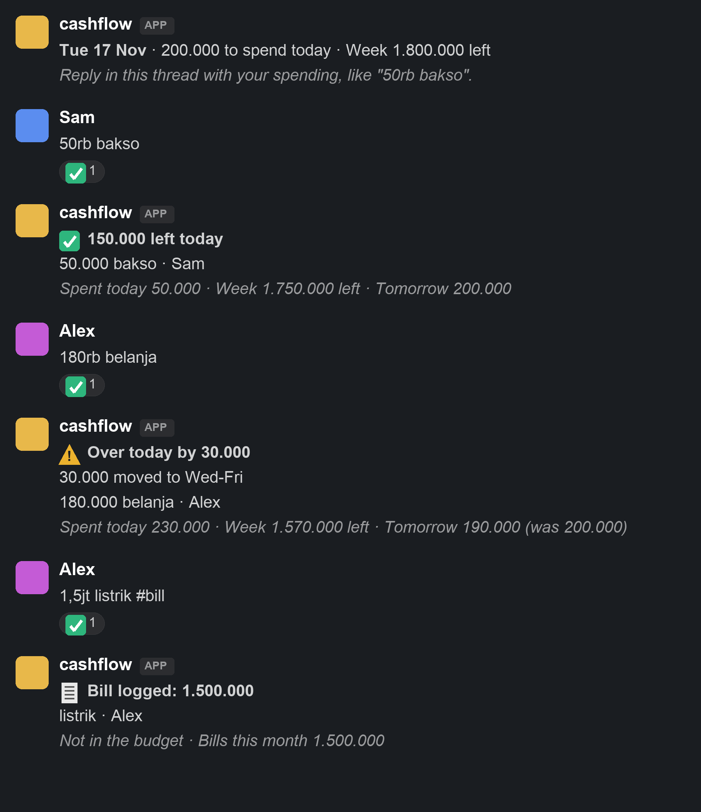

# cashflow

A Slack bot for our household budget. We reply "50rb bakso" in today's thread, and it tells us what is left.

No app, no AI, no server. One Supabase function, about 800 lines of TypeScript, and it runs on the free tier.



The amounts in this README and in the picture are examples. Set your own; see [Make it yours](#make-it-yours).

## How we log

Every night at 00:05 the bot opens a thread for the new day. We reply in it, from our phones:

```
50rb bakso                 50.000
25k makan 5k parkir        30.000, both amounts add up
1,5jt listrik #bill        1.500.000, kept outside the daily budget
kemarin 40rb bensin        logged on yesterday
-20rb refund               takes 20.000 off
0                          nothing spent today
```

The bot puts a check mark on the message and answers. The first line, in bold, is how much is left today. Under it, in grey, is what we spent today, what is left this week and tomorrow's budget.

Made a typo? Edit the message and the reply updates. Delete it and the entry goes away. At 20:00 the bot reminds us if nobody has logged anything that day. On Monday at 00:05 it closes the week and posts a CSV of every entry, as a backup.

## The rules

Out of the box, the budget is 200.000 rupiah on a weekday and 500.000 on Saturday and Sunday, so 2.000.000 a week.

If a day goes over, money we saved earlier in the week pays first. Whatever is left gets split evenly over the weekdays still to come, and no day goes below zero. If the weekdays are used up, the weekend takes it. If the weekend is used up too, it becomes "floating debt".

On Sunday night, any money left pays off the floating debt first. The rest carries over to next week as extra.

Bills tagged `#bill` (electricity, school, rent) are stored, but they never count against the daily budget. They show up as a monthly total.

## Other ways to use it

We use it as a couple, but nothing in it is about couples. It is a daily budget with a weekday amount, a weekend amount and a Slack thread. Some setups that work today, with only the changes listed in [Make it yours](#make-it-yours):

- Just you. Put one name in `CASHFLOW_USER_NAMES`. Everything else works the same.
- A family. Add everyone who spends from the same pot. Each reply says who logged it.
- Housemates with a shared kitchen fund. Set the daily amounts to your grocery money. Log rent and utilities with `#bill`, so they show up but do not eat the daily number.
- A trip with friends. Set the weekday and weekend amounts to the same daily figure. Each day gets its own thread, and the CSV on Monday says who paid for what, so you can settle up. The bot does not split costs between people. You do that from the CSV.
- Pocket money for a teenager. They log, you see the same thread. A refund (`-20rb`) or a correction (edit the message) is part of the deal.
- Office snacks or petty cash. Set the weekend amount to 0. Overspend still moves to the weekdays left, but a Friday overspend has nowhere to go, so it becomes floating debt, unless money saved earlier that week covers it.

## How it is built

- One Supabase Edge Function (Deno, TypeScript) receives Slack events and the `/spent` command.
- Postgres keeps one row per entry. Nothing else is stored: every number is replayed from those rows each time, so fixing an entry from three days ago just works.
- pg_cron calls the same function at 00:05 and 20:00.
- Slack is called with plain `fetch`. The only package is `supabase-js`.
- 43 unit tests, including 500 random weeks that check the money always adds up: what is left at the end equals 2.000.000 plus carry-over minus what we spent.

The budget logic is in [`engine.ts`](supabase/functions/_shared/engine.ts) (about 200 lines) and the input parsing is in [`parse.ts`](supabase/functions/_shared/parse.ts) (about 80).

## What it does not do

We built it for the two of us, in Indonesia. So:

- Rupiah only, Jakarta time (WIB) only.
- It understands the shorthand we use: `rb`, `ribu`, `k`, `jt`, `juta`, and `kemarin` or `yesterday`. Nothing else.
- The budget amounts are constants in the code. To change them, you edit one file (see below).
- One channel, and you type every spend yourself. No bank sync, no charts.
- Supabase pauses free projects after a week with no activity. Daily use keeps it awake.

## Set it up

You need the Supabase CLI and a Slack workspace where you can add apps. It takes about 20 minutes.

1. Create a Supabase project. Then, in this folder:

   ```
   supabase link --project-ref <your-project-ref>
   supabase db push
   ```

2. In the Supabase SQL editor, store 2 values that the cron jobs read. Pick any long random string as the cron secret (`openssl rand -hex 32` works):

   ```sql
   select vault.create_secret('https://<your-project-ref>.supabase.co', 'project_url');
   select vault.create_secret('<cron secret>', 'cron_secret');
   ```

3. Deploy the function:

   ```
   supabase functions deploy slack --no-verify-jwt
   ```

4. Create the Slack app at api.slack.com/apps: "Create New App", then "From a manifest", and paste [`slack-manifest.yaml`](slack-manifest.yaml) with your project ref filled in. Install it, then invite the bot to your channel with `/invite @cashflow`.

5. Add 6 secrets in Supabase (Edge Functions, then Secrets):

   | Name | Value |
   |---|---|
   | `SLACK_BOT_TOKEN` | the `xoxb-` token from "OAuth & Permissions" |
   | `SLACK_SIGNING_SECRET` | from "Basic Information" |
   | `CRON_SECRET` | the same string as in step 2 |
   | `CASHFLOW_CHANNEL_ID` | your channel's ID |
   | `CASHFLOW_START_DATE` | the Monday you start, like `2026-11-16` |
   | `CASHFLOW_USER_NAMES` | Slack member IDs and names, like `U0123ABC=Alex,U0456DEF=Sam` |

6. Back in the Slack app, open "Event Subscriptions" and click "Retry" next to the request URL. It should say "Verified". Post `10rb test` in the channel to check: the bot opens today's thread and answers there.

## Make it yours

Everything you might want to change is in a few short files. Change them before you deploy, or deploy again after.

| What | Where |
|---|---|
| Daily amounts | `WEEKDAY_BUDGET` and `WEEKEND_BUDGET` in [`engine.ts`](supabase/functions/_shared/engine.ts#L15-L16). The week total follows from them. |
| Timezone | `WIB_OFFSET_MS` in [`dates.ts`](supabase/functions/_shared/dates.ts#L3) (UTC+7 now). Change the cron times too, below. |
| When the day thread opens and when the reminder comes | The `cron.schedule` lines in [`day_threads.sql`](supabase/migrations/20261117100000_day_threads.sql#L14) (`5 17 * * *`, which is 00:05 in Jakarta) and [`init.sql`](supabase/migrations/20261117000000_init.sql#L35) (`0 13 * * *`, 20:00 in Jakarta). They are in UTC. Edit them before your first `supabase db push`. On a project that is already set up, add a new migration that calls `cron.unschedule` and `cron.schedule` again. |
| Money words | `SUFFIX` in [`parse.ts`](supabase/functions/_shared/parse.ts#L16) (`rb`, `k`, `jt`...) and the "yesterday" words on [line 55](supabase/functions/_shared/parse.ts#L55). |
| How numbers look | `rupiah()` in [`parse.ts`](supabase/functions/_shared/parse.ts#L80). It writes `1.750.000`. |
| What the bot says | `spendReply`, `dayHeaderText` and `reminderInThread` in [`format.ts`](supabase/functions/_shared/format.ts). |
| Who is who, the channel, the first Monday | The secrets in step 5. No code change. |

After a code change, run `npm test`, then `supabase functions deploy slack --no-verify-jwt`.

## Tests

```
npm test
```

Needs Node 22.18 or newer (we use 24). No install step: there are no npm dependencies.

## Contributing

This started as a thing for our home, so it is small on purpose. Changes that keep it small are the easiest to merge.

To work on it:

```
git clone https://github.com/regahr/cashflow
cd cashflow
npm test
cd supabase/functions/slack && deno check --config deno.json index.ts
```

Where things are:

- [`engine.ts`](supabase/functions/_shared/engine.ts) has the budget rules. It is plain functions with no I/O, so it is easy to test.
- [`parse.ts`](supabase/functions/_shared/parse.ts) turns "25k makan 5k parkir" into an amount and a note.
- [`format.ts`](supabase/functions/_shared/format.ts) writes the replies.
- [`slack/index.ts`](supabase/functions/slack/index.ts) handles Slack, the database and the cron jobs.

If you change a rule, add a case to `test/engine.test.ts` that shows the new behaviour. The test with 500 random weeks has to keep passing: it is the check that the money adds up.

For anything bigger, please open an issue first, so we can talk about it before you spend the time. Ideas we would like help with:

- Other currencies and other money words, for example "5k" in dollars or "1,2 Mio".
- Budget amounts and the timezone from secrets, so nobody has to edit code.
- A budget for each person on top of the shared one.
- A monthly summary by note, from `/spent month`.

One thing we will keep: no LLM in the money math. The same messages should always give the same numbers.

Then fork, make a branch, check that `npm test` passes, and open a pull request that says what changed and why.

## License

MIT
